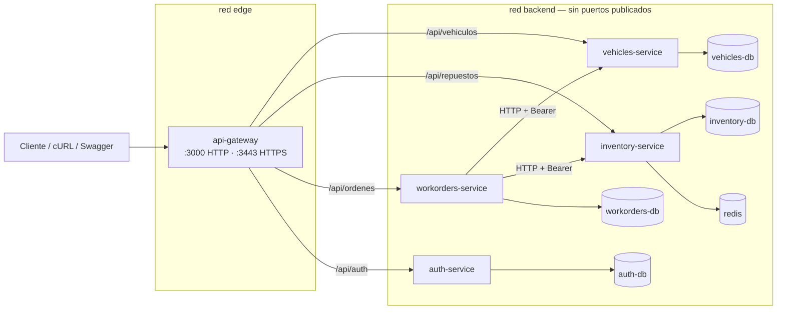

# torque

Gestión de taller mecánico. Es el proyecto grupal de **Programación Distribuida** (UCH).

Es un repositorio **único y evolutivo**: no se crea un repo nuevo por entrega, se marca con tags (`tp5-entrega`, `tp6-entrega`, …).

| TP | Qué se hizo | Dónde |
|---|---|---|
| TP5 | Análisis y diseño de microservicios | `docs/arquitectura.md`, `docs/01…03`, `docs/diagrama-arquitectura.md` |
| TP6 | Implementación de los microservicios + Docker / Docker Compose | `services/`, `docker-compose.yml`, [`docs/tp6/`](docs/tp6/README.md) |
| TP7 | Autenticación y autorización con JWT (auth-service, roles, propiedad) | `services/auth-service/`, [`docs/tp7/`](docs/tp7/README.md), [§ Seguridad](#seguridad-tp7) |
| **Correcciones** | **Requisitos redefinidos tras la primera revisión:** alta administrada, sesión renovable, vehículos con dueño y baja lógica, inventario con movimientos, reposición, cancelación y estados, laboratorio por variable, métricas | [`docs/correcciones/`](docs/correcciones/README.md), [§ Correcciones](#correcciones-de-la-primera-revisión) |

## Integrantes

| Nombre | GitHub | Aporte TP6 | Aporte TP7 |
|---|---|---|---|
| Gregorio Luján | [@lujangrego99](https://github.com/lujangrego99) | plan (Hito 1), `api-gateway`, Docker Compose, scripts de prueba, documentación integrada | plan (Hito 1), `auth-service`, gateway + Compose, pruebas de seguridad |
| Manuel Moya | [@ManusMoya](https://github.com/ManusMoya) | `vehicles-service`, casos de uso | JWT + roles en `vehicles-service`, 401 vs 403 |
| Jan Lahorca | [@janlahorca](https://github.com/janlahorca) | `inventory-service`, semántica de errores | JWT + roles en `inventory-service`, secretos y configuración |
| Agustín Martínez | [@AgustinEMCE](https://github.com/AgustinEMCE) | `workorders-service`, análisis de fallo parcial | JWT en `workorders-service`, propagación del token, propiedad de órdenes |

Docentes colaboradores: `alvarezadriel@uch.edu.ar`, `cortezedgardo@uch.edu.ar`.

---

## 1. Arquitectura implementada



| Servicio | Responsabilidad | Datos propios | Habla con |
|---|---|---|---|
| `api-gateway` | Punto de entrada único: HTTPS, enrutamiento por prefijo, Swagger agregado. Reenvía `Authorization` (no valida) | — | los 4 servicios |
| `auth-service` (TP7) | **Identidad**: alta administrada, login, sesión renovable (refresh token), bcrypt, emisión de JWT, administración de usuarios | `auth-db` → `usuarios`, `sesiones` | — |
| `vehicles-service` | Parque de vehículos: alta con dueño, patente única (duplicado detectado), baja lógica. Valida JWT | `vehicles-db` → `vehiculos` | — |
| `inventory-service` | Stock de repuestos: alta, ingreso, ajuste, descuento con lock Redis, reposición y **libro de movimientos**. Valida JWT | `inventory-db` → `repuestos`, `movimientos` · `redis` (locks) | — |
| `workorders-service` | Órdenes de trabajo: ciclo de vida (en proceso, finalizada, cancelada, fallida), descuenta y repone repuestos, historial por vehículo. Valida JWT, propaga el token y aplica propiedad | `workorders-db` → `ordenes` | vehicles, inventory |

Ningún servicio accede a la base de otro (tampoco a la de usuarios). Detalle: [TP6 Hito 1](docs/tp6/01-plan-implementacion.md) · [TP7 Hito 1](docs/tp7/01-plan-implementacion.md).

### Cambios respecto del TP5

- **Nuevo `workorders-service`.** El TP5 ya lo dejaba previsto (§11: "un cuarto bounded context de órdenes de trabajo"). Hace falta para tener una operación que cambie estado en dos servicios: es la comunicación real y el fallo parcial que pide el TP6.
- **Una instancia MongoDB por servicio**, en lugar de compartir una instancia con bases separadas.
- **HTTPS solo en el gateway.** Entre contenedores se usa HTTP.
- **Logs a stdout** en lugar de archivos rotativos.
- `monolito/` (TP3) queda como referencia histórica y no forma parte del Compose.

Justificación completa: [01-plan-implementacion.md §4](docs/tp6/01-plan-implementacion.md#4-cambios-respecto-del-tp5-y-por-qué).

---

## 2. Requisitos

- **Docker** con **Docker Compose v2**: Docker Desktop con backend WSL 2 en Windows, o Docker Engine con el plugin compose en Linux.
- `bash` + `curl` + `node` para los scripts de prueba (Linux, WSL o Git Bash).
- Opcional, para correr sin Docker: Node.js ≥ 20, MongoDB y Redis o Memurai.

Verificación de Docker:

```bash
wsl --status                # solo Windows
docker --version
docker compose version
docker info
docker run --rm hello-world
```

Evidencias de cada integrante: `docs/tp6/evidencias/docker-*.txt`.

## 3. Levantar la solución (un solo comando)

```bash
git clone https://github.com/lujangrego99/torque.git
cd torque
bash scripts/generar-env.sh                           # TP7: crea .env con JWT_SECRET y ADMIN_PASSWORD aleatorios
bash services/api-gateway/scripts/generar-certificado.sh   # opcional: habilita HTTPS en :3443
docker compose up --build
```

Otros comandos útiles:

```bash
docker compose config          # valida el archivo
docker compose ps              # estado + (healthy)
docker compose logs -f         # logs de todos   ·  docker compose logs -f workorders-service
docker compose down            # detiene y CONSERVA los datos
docker compose down -v         # detiene y BORRA los volúmenes (estado inicial)
```

## 4. Puertos, URLs y nombres internos

Solo el gateway publica puertos hacia la PC:

| Desde la PC | URL |
|---|---|
| API (HTTP) | `http://localhost:3000/api/...` |
| API (HTTPS, si hay certificado) | `https://localhost:3443/api/...` (`curl -k`) |
| **Swagger** (los 4 contratos, con selector) | `http://localhost:3000/api-docs` |
| Salud del gateway | `http://localhost:3000/health` |
| Salud de todos los servicios | `http://localhost:3000/health/servicios` |
| Métricas (gateway / todos los servicios) | `http://localhost:3000/metrics` · `http://localhost:3000/metrics/servicios` |

Dentro de la red de Compose cada contenedor se alcanza por **nombre de servicio + puerto interno**. Nunca se usa `localhost` ni una IP fija:

| Origen | Destino | URL interna |
|---|---|---|
| api-gateway | vehicles-service | `http://vehicles-service:3000` |
| api-gateway | inventory-service | `http://inventory-service:3000` |
| api-gateway | workorders-service | `http://workorders-service:3000` |
| api-gateway | auth-service | `http://auth-service:3000` |
| workorders-service | vehicles-service / inventory-service | `http://vehicles-service:3000` · `http://inventory-service:3000` |
| vehicles-service | su base | `mongodb://vehicles-db:27017/vehicles` |
| inventory-service | su base / Redis | `mongodb://inventory-db:27017/inventory` · `redis://redis:6379` |
| workorders-service | su base | `mongodb://workorders-db:27017/workorders` |
| auth-service | su base | `mongodb://auth-db:27017/auth` |

Cada servicio expone `GET /health` y `GET /api-docs` en su puerto interno 3000. Desde la PC se ven a través del gateway (`/health/servicios`, `/api-docs`).

## 5. Variables de entorno

| Archivo | Para qué |
|---|---|
| `.env.example` (raíz) | variables de `docker-compose.yml`. **Obligatorias desde el TP7:** `JWT_SECRET`, `ADMIN_PASSWORD` (las completa `scripts/generar-env.sh`). Opcionales: vigencia del token, bcrypt, puertos, timeouts, lock |
| `services/<servicio>/.env.example` | variables de cada servicio para correrlo con Node, con los valores locales |

Ningún `.env` real, clave ni certificado se versiona (`.gitignore`), y tampoco entra en las imágenes (`.dockerignore`).

### Local vs. Docker Compose: solo cambia la configuración

| Variable | Ejecución local (Node) | Docker Compose |
|---|---|---|
| `PORT` | 3001 / 3002 / 3003 / 3000 | 3000 en todos (puerto interno) |
| `MONGODB_URI` | `mongodb://127.0.0.1:27017/<base>` | `mongodb://<servicio>-db:27017/<base>` |
| `REDIS_URL` | `redis://127.0.0.1:6379` (Redis o Memurai) | `redis://redis:6379` |
| `*_SERVICE_URL` | `http://localhost:300x` | `http://<servicio>:3000` |
| `SSL_*_PATH` | `./certs/...` | `/app/certs/...` (volumen) |

Con `bash scripts/prueba-local.sh` se corren los 4 servicios con Node, con el mismo código, cambiando solo esas variables. Evidencia en `docs/tp6/evidencias/13-ejecucion-local.txt`.

## 6. Inicio y disponibilidad de dependencias

- **Bases y Redis** tienen healthcheck (`mongosh ping` / `redis-cli ping`). Cada servicio espera a **su** base con `depends_on: condition: service_healthy`.
- **Cada microservicio** tiene healthcheck en Compose (y en su Dockerfile) contra su `/health`. Se ejecuta con `node -e "fetch(...)"`, que ya viene en la imagen, sin depender de curl ni wget.
- `/health` responde **200 solo si el servicio puede atender**, es decir, si su base está conectada. Si el proceso está vivo pero sin base, responde **503** (`degraded`). Así se distingue un contenedor iniciado de un servicio disponible.
- Las dependencias **entre servicios** usan solo `service_started`: si `inventory-service` está caído, el gateway y workorders arrancan igual y responden 503 controlado.
- **La aplicación no confía en el orden de inicio.** Abre el puerto enseguida y conecta a Mongo con reintentos (`MONGO_RETRY_MS`). Redis reconecta solo. `bufferCommands=false` hace que, sin base, la consulta falle en el momento (503) en vez de quedar colgada.

## 7. Volúmenes y persistencia

| Volumen | Montado en | Contenido |
|---|---|---|
| `torque_vehicles-data` | `vehicles-db:/data/db` | vehículos |
| `torque_inventory-data` | `inventory-db:/data/db` | repuestos |
| `torque_workorders-data` | `workorders-db:/data/db` | órdenes |
| `torque_auth-data` | `auth-db:/data/db` | usuarios (hash bcrypt, rol, activo) |

Redis no tiene volumen a propósito: los locks son efímeros (TTL) y no hay nada que conservar.

- `docker compose down` elimina contenedores y red, pero **conserva los volúmenes**. Al hacer `up` de nuevo, los datos siguen ahí y el seed se omite porque las colecciones no están vacías.
- `docker compose down -v` **borra los volúmenes**. Al hacer `up`, se vuelve a sembrar el estado inicial. Usarlo solo para reiniciar el laboratorio a propósito.

Prueba: `bash scripts/pruebas-tp6.sh 07-persistencia`.

## 8. Logs

Todos los servicios loguean a stdout con el formato `timestamp [NIVEL] [servicio] mensaje`, con método, ruta, status, duración y `rid` (request id). El gateway genera el `x-request-id` y lo propaga, así que una orden se sigue de punta a punta:

```bash
docker compose logs -f
docker compose logs workorders-service | grep ERROR
docker compose logs | grep <rid>
```

## 9. Comportamiento ante una dependencia caída

| Caída | Efecto |
|---|---|
| `inventory-service` | `/api/repuestos` → **503** del gateway (`causa: dns`). `POST /api/ordenes` → **503** de workorders, sin crear orden. Vehículos y consulta de órdenes **siguen funcionando**. |
| `vehicles-service` | `/api/vehiculos` → 503. Las órdenes nuevas → 503 (no se puede validar el vehículo). |
| `vehicles-db` / `inventory-db` / `workorders-db` | el servicio dueño responde 503 en sus operaciones y `/health` = 503. Se recupera solo al volver la base. |
| `redis` | `POST /api/repuestos/:id/descontar` → 503. Las consultas de stock siguen. `/health` de inventory = `degraded`. |
| `inventory-service` al cancelar | La orden se cancela igual; la reposición queda `PENDIENTE` y se reintenta con `POST /api/ordenes/:id/reponer` (el descuento sigue en el libro de movimientos). |

Los errores **funcionales** remotos (404, 409) no se convierten en 503: se propagan. Tabla completa: [semantica-errores.md](docs/tp6/semantica-errores.md).

## 10. Fallo parcial (operación distribuida)

Crear una orden con varios repuestos descuenta stock **ítem por ítem** en inventory-service, cada descuento ligado al `ordenId`. Si el ítem 2 falla (sin stock, o timeout), el ítem 1 ya quedó descontado: la orden queda `FALLIDA` y **lo descontado vuelve solo al stock** con un contramovimiento `REPOSICION` de la misma orden (no un rollback). Un timeout deja el ítem `INCIERTO`; la reposición lo resuelve consultando el libro de movimientos. Detalle: [docs/correcciones §3.2–3.3](docs/correcciones/README.md#32-libro-de-movimientos-y-reposición-requisitos-9-y-10).

Análisis completo, cambios de estado, qué pasa en cada etapa y qué haría falta para compensar: [fallo-parcial.md](docs/tp6/fallo-parcial.md).

## 11. Datos de prueba (estado inicial conocido)

| Seed | Ids fijos |
|---|---|
| Vehículos | Corolla `68c000000000000000000001` · Ranger `…002` · Gol `…003` |
| Repuestos | Filtro `68c000000000000000000011` (stock 1) · Pastillas `…012` (4) · Bujías `…013` (8) |
| Órdenes | ninguna |
| Vehículos (dueño) | Laura Gómez · Martín Sosa · Carla Ruiz |
| Movimientos | un INGRESO "Stock inicial (semilla)" por repuesto |
| Usuarios | solo el admin inicial (`ADMIN_EMAIL` / `ADMIN_PASSWORD` de `.env`). Las pruebas dan de alta (como ADMIN) `mecanico1@torque.local` y `mecanico2@torque.local` |

```bash
bash scripts/reset-datos.sh          # restaura stock y movimientos (POST /api/repuestos/reiniciar, requiere LAB_ENDPOINTS=true)
bash scripts/reset-datos.sh --todo   # down -v + up: todo vuelve a la semilla
```

## 12. Pruebas

```bash
bash scripts/pruebas-correcciones.sh        # correcciones de la 1ª revisión. Salida en docs/correcciones/evidencias/
bash scripts/pruebas-tp7.sh                 # TP7: seguridad, escenarios A–L (+ extras). Salida en docs/tp7/evidencias/
bash scripts/pruebas-tp6.sh                 # TP6 (≈ 3 min), corre como ADMIN. Deja la salida en docs/tp6/evidencias/
bash scripts/pruebas-tp6.sh 08-fallo        # solo una sección
bash scripts/prueba-local.sh                # mismos servicios con Node, sin Docker para las apps
```

| Prueba (TP6 §18) | Sección / evidencia |
|---|---|
| Build individual | `01-build-individual` |
| Inicio con Compose | `02-compose-up` |
| Health | `03-health` |
| CRUD / negocio | `04-crud` |
| Comunicación entre servicios | `05-comunicacion` |
| Propiedad de datos | `06-propiedad-datos` |
| Persistencia | `07-persistencia` |
| Fallo de dependencia | `08-fallo-dependencia` |
| Fallo parcial | `09-fallo-parcial` + [análisis](docs/tp6/fallo-parcial.md) |
| Logs | `10-logs` |
| Swagger | `11-swagger` |
| Datos de prueba | `12-datos-prueba` |
| Configuración por entorno | `13-ejecucion-local` |
| Startup / disponibilidad | `01` (imagen sola sin base → 503 y reintento) · `08` (base caída y recuperación) |

Índice de evidencias: [TP6](docs/tp6/README.md) · [TP7 (escenarios A–L)](docs/tp7/README.md#evidencias-evidencias) · [Correcciones](docs/correcciones/README.md).

Los tres scripts usan los endpoints de laboratorio y fuerzan `LAB_ENDPOINTS=true`. Por defecto están apagados.

## Seguridad (TP7)

Detalle y decisiones: [docs/tp7/](docs/tp7/README.md).

### Cambios respecto del TP6

- **Nuevo `auth-service` + `auth-db`.** El TP6 no tenía ningún servicio dueño de usuarios. La identidad no se mezcló con un servicio del taller.
- **vehicles, inventory y workorders** suman el mismo middleware de validación. No cambian sus reglas de negocio ni sus datos.
- **workorders** guarda `creadaPor` (el `sub` del token) en cada orden y propaga el token a vehicles e inventory.
- **api-gateway** suma la ruta `/api/auth` y reenvía `Authorization`. No valida tokens ni conoce el secreto.
- `scripts/pruebas-tp6.sh` y `reset-datos.sh` operan con el token del admin inicial.

### Identidad y roles

- **`auth-service`** es el único responsable de identidad: guarda usuarios con contraseña **bcrypt** (costo 12) en su propia base y emite los JWT. Ningún otro servicio guarda usuarios ni compara contraseñas.
- **Roles:** `MECANICO` (empleado del taller) y `ADMIN` (jefe de taller).
- **Alta administrada** (corrección del requisito 1): no hay registro abierto. El primer `ADMIN` se crea al arrancar con `ADMIN_EMAIL` / `ADMIN_PASSWORD` del `.env`, y es quien da de alta a los mecánicos (`POST /api/auth/usuarios`). Un ADMIN puede promover o deshabilitar usuarios (`PATCH /api/auth/usuarios/:id`); deshabilitar revoca sus sesiones.

Matriz de acceso completa (actualizada con las correcciones): [docs/correcciones §2](docs/correcciones/README.md#2-matriz-de-acceso-actualizada). Resumen:

| Endpoint | Sin token | MECANICO | ADMIN |
|---|---|---|---|
| `POST /api/auth/login` · `/refresh` · `/logout` | ✔ | ✔ | ✔ |
| `POST/GET/PATCH /api/auth/usuarios…` | 401 | 403 | ✔ |
| `GET /api/repuestos…` (stock, movimientos) | 401 | ✔ | ✔ |
| alta, ingreso y ajuste de repuestos | 401 | 403 | ✔ |
| `GET/POST/PUT /api/vehiculos…` | 401 | ✔ | ✔ |
| `DELETE /api/vehiculos/:id` (baja lógica) | 401 | 403 | ✔ |
| `reiniciar` · `lock` · `descontar-sin-lock` | 404 salvo `LAB_ENDPOINTS=true` (entonces 401 / 403 / ✔) | | |
| `POST /api/ordenes` | 401 | ✔ | ✔ |
| `GET/PATCH /api/ordenes/:id` · cancelar · finalizar | 401 | **solo las propias** (ajena → 403) | todas |
| `GET /api/ordenes/vehiculo/:id` (historial) | 401 | todas, solo lectura | todas |

### Variables de seguridad

| Variable | Obligatoria | Por defecto | Para qué |
|---|---|---|---|
| `JWT_SECRET` | **sí** | — | clave HS256 (≥ 32 caracteres). La misma para firmar (auth) y verificar (vehicles, inventory, workorders) |
| `ADMIN_PASSWORD` | **sí** | — | contraseña del admin inicial |
| `ADMIN_EMAIL` | no | `admin@torque.local` | email del admin inicial |
| `JWT_EXPIRES_IN` | no | `5m` | vigencia del access token (se renueva con `/refresh`) |
| `SESSION_IDLE` | no | `15m` | la sesión vence si no se renueva en este lapso |
| `LAB_ENDPOINTS` | no | `false` | habilita los endpoints de laboratorio de inventory |
| `BCRYPT_ROUNDS` | no | `12` | costo de bcrypt |

`bash scripts/generar-env.sh` crea `.env` (no versionado) con valores aleatorios
para las dos obligatorias. Sin ellas, `docker compose up` no arranca y muestra
qué falta.

### Dar de alta, loguearse, usar y renovar el token

```bash
J='content-type: application/json'
login() { curl -s -X POST http://localhost:3000/api/auth/login -H "$J" -d "{\"email\":\"$1\",\"password\":\"$2\"}"; }
set -a; . ./.env; set +a

# 1. El ADMIN da de alta un mecánico (alta administrada)
ADMIN=$(login "$ADMIN_EMAIL" "$ADMIN_PASSWORD" | node -pe 'JSON.parse(require("fs").readFileSync(0)).accessToken')
curl -X POST http://localhost:3000/api/auth/usuarios -H "$J" -H "Authorization: Bearer $ADMIN" \
  -d '{"email":"juan@torque.local","nombre":"Juan Pérez","password":"una-clave-segura"}'

# 2. Login del mecánico → accessToken (5 min) + refreshToken
R=$(login juan@torque.local una-clave-segura)
TOKEN=$(echo "$R" | node -pe 'JSON.parse(require("fs").readFileSync(0)).accessToken')
REFRESH=$(echo "$R" | node -pe 'JSON.parse(require("fs").readFileSync(0)).refreshToken')

# 3. Usarlo en un endpoint protegido
curl http://localhost:3000/api/vehiculos -H "Authorization: Bearer $TOKEN"

# 4. Antes de que venza: renovar (devuelve un par nuevo; el refresh anterior deja de servir)
curl -X POST http://localhost:3000/api/auth/refresh -H "$J" -d "{\"refreshToken\":\"$REFRESH\"}"

# 5. Cerrar sesión (revoca la renovación)
curl -X POST http://localhost:3000/api/auth/logout -H "$J" -d "{\"refreshToken\":\"<el último refresh>\"}"
```

**Swagger** (`http://localhost:3000/api-docs`): elegir *auth-service (login)* en
el selector → `POST /api/auth/login` → copiar `accessToken` → botón
**Authorize**. El token se conserva al cambiar de servicio en el selector. Cada
operación muestra el candado, el rol requerido y sus respuestas 401/403.

### Validación y propagación del JWT

- Claims: `sub`, `rol`, `sid` (sesión), `iss`, `aud`, `iat`, `exp`. Sin email, nombre, contraseña ni hash.
- Cada servicio valida el token **localmente** (`src/middleware/auth.js`: HS256 explícito, firma, emisor, audiencia y vencimiento), sin consultar la base de usuarios. Respuestas: **401** sin identidad válida, **403** con identidad válida sin permiso.
- El **gateway no valida**: reenvía `Authorization` tal cual. Así ningún servicio queda abierto si se le llega desde adentro de la red.
- **Propagación:** al crear una orden, workorders reenvía el mismo token del usuario a vehicles e inventory, y cada uno lo vuelve a validar. La orden queda a nombre del `sub` (`creadaPor`).
- Si **auth-service se cae**, los tokens ya emitidos siguen valiendo hasta su `exp`. Solo fallan login, renovación y altas (503).

Pruebas: `bash scripts/pruebas-tp7.sh` (escenarios A–L del §19 + auth caído,
Swagger y secretos). Evidencias e índice: [docs/tp7/README.md](docs/tp7/README.md).

## Correcciones de la primera revisión

Detalle requisito por requisito, decisiones y evidencias: **[docs/correcciones/](docs/correcciones/README.md)**.

| # | Corrección | Cómo se prueba |
|---|---|---|
| 1 | Alta de usuarios administrada (`POST /api/auth/usuarios`, ADMIN) | `pruebas-correcciones.sh 01-` |
| 3 | Access token de 5 min + refresh rotativo, vence a los 15 min sin uso, logout | `02-` |
| 4 | Vehículo con dueño, duplicado detectado (409 + existente), baja lógica, historial | `03-` · `09-` |
| 5 | Stock solo para usuarios autenticados | `04-` |
| 6 · 7 · 9 | Alta de repuestos, ingreso, ajuste con motivo, libro de movimientos | `05-` |
| 10 · 14 | Cancelación (dueño o ADMIN, motivo/quién/cuándo) y reposición automática con contramovimiento | `06-` · `07-` · `11-` |
| 13 | Estados PENDIENTE, EN_PROCESO, FINALIZADA, CANCELADA, FALLIDA | `08-` |
| 16 | Endpoints de laboratorio solo con `LAB_ENDPOINTS=true` | `10-` |
| NF | `GET /metrics` por servicio y `/metrics/servicios` en el gateway | `12-` |

## 13. Estructura del repositorio

```
torque/
├── docker-compose.yml          solución integrada
├── .env.example                variables de Compose (JWT_SECRET y ADMIN_PASSWORD obligatorias)
├── services/
│   ├── api-gateway/            Dockerfile · .dockerignore · .env.example · README · src/
│   ├── auth-service/           ídem (TP7)
│   ├── vehicles-service/       ídem
│   ├── inventory-service/      ídem
│   └── workorders-service/     ídem
├── scripts/                    generar-env.sh · pruebas-correcciones.sh · pruebas-tp7.sh · pruebas-tp6.sh · prueba-local.sh · reset-datos.sh
├── docs/
│   ├── correcciones/           requisitos redefinidos tras la 1ª revisión: decisiones, matriz de acceso, evidencias
│   ├── tp7/                    plan de seguridad, 401/403, secretos, propagación, evidencias
│   ├── tp6/                    plan, casos de uso, errores, fallo parcial, evidencias
│   └── (TP5)                   arquitectura, inventario, acoplamientos, diagrama
└── monolito/                   TP3 (referencia histórica, no se usa en Compose)
```

Cada servicio separa `routes/` → `controllers/` → `services/` (negocio) → `models/` / `clients/` (persistencia propia / otros servicios) → `config/`.

## Flujo de Git

- Rama principal: `main`. Todo entra por **Pull Request** desde ramas `feature/…`, `docs/…` o `fix/…`.
- Entregas: tags `tp6-entrega`, `tp7-entrega` y `correcciones-rev1` sobre el `main` integrado y probado.
