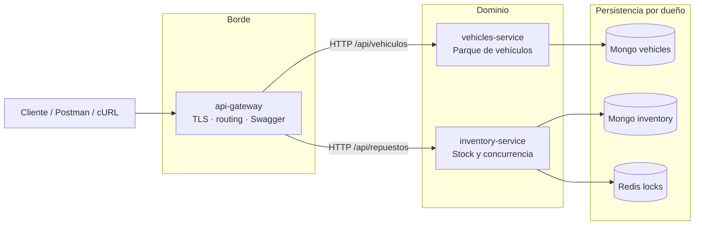

# Datos, comunicaciones, casos de uso y checklist

**TP5 · torque** · Grupo

Propiedad de datos, comunicaciones, trazado de casos de uso y checklist de límites.

---

## 8. Propiedad de los datos

| Dato / recurso | Servicio propietario | Quién puede consultarlo | Quién puede modificarlo | Forma de acceso |
|---|---|---|---|---|
| Vehículo | `vehicles-service` | Gateway / clientes vía API pública del servicio | Solo `vehicles-service` | HTTP REST del servicio |
| Patente (unicidad) | `vehicles-service` | Igual | Solo `vehicles-service` | Regla interna + índice único |
| Repuesto / stock | `inventory-service` | Gateway / clientes vía API pública | Solo `inventory-service` | HTTP REST del servicio |
| Lock `lock:repuesto:{id}` | `inventory-service` | Diagnóstico del mismo servicio | Solo `inventory-service` | Redis interno (no expuesto como API de negocio) |
| Spec OpenAPI agregada | `api-gateway` | Clientes | Gateway (agrega specs de origen) | `/api-docs` |

Regla: nadie escribe en la DB ajena. Si en el futuro una orden de trabajo necesitara descontar stock, llamaría a `inventory-service`, no al Mongo de inventario.

---

## 9. Comunicación entre servicios

| Origen | Destino | Necesidad | Método / endpoint | Datos | Respuesta |
|---|---|---|---|---|---|
| Cliente | `api-gateway` | Usar la API | `* /api/...` | según operación | según servicio |
| `api-gateway` | `vehicles-service` | CRUD flota | `* /api/vehiculos...` | body/params vehículo | 200/201/204/4xx |
| `api-gateway` | `inventory-service` | Stock / descuento | `* /api/repuestos...` | id, cantidad | 200/409/503/… |

En esta etapa **no** hay llamada vehicles ↔ inventory: hoy no existe un caso de uso que las una. Eso es intencional (bajo acoplamiento).

Preguntas de control:

- ¿Hace falta que vehicles conozca inventory? **No** todavía.  
- ¿Se duplica alguna regla? **No**: patente vive solo en vehicles; stock solo en inventory.  
- ¿Si inventory cae? Las operaciones de flota siguen; fallan solo las de stock (gateway responde error del backend).

### 9.1 Trazado de casos de uso

**CU1 — Alta de vehículo**

```
Cliente
  │ HTTPS POST /api/vehiculos
  ▼
api-gateway          (TLS, route; sin reglas de patente)
  │ HTTP POST /api/vehiculos
  ▼
vehicles-service     (valida, unicidad, persiste)
  │
  ▼
201 + vehículo
```

**CU2 — Descontar stock (camino seguro)**

```
Cliente
  │ HTTPS POST /api/repuestos/:id/descontar
  ▼
api-gateway
  │ HTTP POST .../descontar
  ▼
inventory-service    (lock Redis → validar stock → $inc → release)
  │
  ▼
200 stock actualizado  |  409 sin stock  |  503 Redis caído
```

---

## 10. Diagrama de arquitectura



Archivo en repo: `docs/diagrama-arquitectura.md`.

---

## 11. Checklist de validación de límites

Revisado por el grupo sobre los tres servicios:

- [x] Responsabilidad principal en una frase clara.  
- [x] Agrupa reglas de negocio relacionadas.  
- [x] Posee datos/decisiones propios (gateway: config de borde; no inventa dominio).  
- [x] No se creó “porque hay una tabla” sola: vehicles e inventory son capacidades; gateway es borde.  
- [x] Interfaz pública sin exponer Mongo/Redis internos.  
- [x] Pueden evolucionar sin redeploy conjunto (salvo contrato del gateway).  
- [x] No duplican reglas ajenas.  
- [x] Dependencias justificadas (solo gateway → servicios).  
- [x] Fuera de alcance explícito en cada ficha.

Si más adelante aparece “usar repuesto en un vehículo”, se evaluará un cuarto bounded context (p. ej. órdenes de trabajo) en lugar de fusionar vehicles e inventory.

---


---

## Diagrama

El diagrama Mermaid vive también en [`diagrama-arquitectura.md`](./diagrama-arquitectura.md). Este aporte lo valida y lo enlaza con las matrices de arriba.
