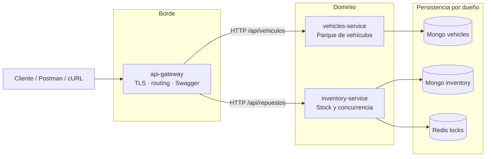

# TP05 — De API REST a Microservicios

**Materia**: Programación Distribuida (UCH)  
**Modalidad**: Grupal (3–5)  
**Fecha**: 2026-10-22  
**Grupo**: torque  
**Integrantes**: Gregorio Luján · Manuel Moya · Jan Lahorca · Agustín Martínez  
**Repo**: https://github.com/lujangrego99/torque  
**Enunciado**: [[Programacion-Distribuida/Enunciado-TP05.pdf|Enunciado-TP05.pdf]]

Copia canónica de la arquitectura también en el repo: `docs/arquitectura.md`.

---

## 1. Objetivo de esta etapa

Evolucionar el taller (API REST de TPs 1–4) hacia microservicios. En el TP5 **no** se exige migrar todo el código: se exige justificar límites, datos, comunicaciones y dejar un repo colaborativo listo para los TPs siguientes.

---

## 2. Integrantes y colaboración

| Integrante | GitHub |
|---|---|
| Gregorio Luján | `lujangrego99` |
| Manuel Moya | `ManusMoya` |
| Jan Lahorca | `janlahorca` |
| Agustín Martínez | `AgustinEMCE` |

Docentes colaboradores (emails del enunciado): `alvarezadriel@uch.edu.ar`, `cortezedgardo@uch.edu.ar`.

Flujo: ramas por tarea → Pull Request → review → merge a `main`. Tag de entrega: `tp5-entrega`.

---

## 3. Punto de partida

**Versión base**: monolito del **TP3** (persistencia MongoDB + Winston + Swagger + HTTPS + lock Redis) ubicado en `monolito/` del repo.

Dominio: taller mecánico.

| Capacidad | Qué hace hoy |
|---|---|
| Vehículos | CRUD con patente única sobre MongoDB |
| Repuestos / stock | Listado; descuento con y sin lock Redis |
| Transversal | HTTPS, Winston, Swagger/OpenAPI, MongoDB, Redis |

**Por qué no TP4**: el Raft del TP4 replica el monolito entero (Leader, log, quorum). Eso es un ejercicio de consenso, no un límite de negocio. Mezclarlo con la separación en microservicios obliga a arrastrar cluster, 503 de follower y State Machine a cada corte. El grupo acordó usar el TP3 como base limpia; el TP4 queda como trabajo individual previo fuera de este repo.

---

## 4. Inventario de la aplicación actual

| Funcionalidad / endpoint | Responsabilidad actual | Datos utilizados | Dependencias |
|---|---|---|---|
| `GET /api/vehiculos` | Listar parque de vehículos | `vehiculos` (Mongo) | — |
| `GET /api/vehiculos/:id` | Obtener un vehículo | `vehiculos` | — |
| `POST /api/vehiculos` | Alta de vehículo | marca, modelo, año, patente, km | Validación + Mongo |
| `PUT /api/vehiculos/:id` | Reemplazo completo | mismos campos + id | Idem. + unicidad de patente |
| `DELETE /api/vehiculos/:id` | Baja | id | Mongo |
| `GET /api/repuestos` | Listar stock | `repuestos` | — |
| `GET /api/repuestos/:id` | Obtener repuesto | `repuestos` | — |
| `GET /api/repuestos/:id/lock` | Diagnosticar lock | Redis `lock:repuesto:{id}` | Redis |
| `POST /api/repuestos/:id/descontar-sin-lock` | Demo carrera (check-then-act) | stock | Sin Redis; puede oversell |
| `POST /api/repuestos/:id/descontar` | Descontar stock con exclusión mutua | stock, cantidad | Redis lock → Mongo |
| `POST /api/repuestos/reiniciar` | Reset demo de stock | seeds de repuestos | Seed / Mongo |
| `GET /api-docs` (+ `.json`) | Documentación OpenAPI | spec generada | Toda la API |
| HTTPS / Winston / seed | Arranque, logs, datos iniciales | `.env`, certs, logs | Mongo + Redis |

Reglas de negocio vigentes:

- Patente única (conflicto → 409).
- Validación de campos de vehículo (tipos, rangos, formato de patente).
- Stock insuficiente → 409 en el camino con lock; el camino sin lock existe a propósito para demo de carrera.
- Si Redis no está, el descuento con lock responde 503.
---

## 5. Identificación de responsabilidades

### R1 — Gestión del parque de vehículos

1. **Problema**: registrar y mantener los vehículos que el taller atiende.  
2. **Operaciones**: listar, obtener, alta, actualización, baja.  
3. **Reglas**: validación de campos; unicidad de patente.  
4. **Necesita**: datos del vehículo.  
5. **Crea/modifica**: colección `vehiculos`.  
6. **Conoce**: hoy no necesita repuestos.  
7. **Cambian juntos**: altas/bajas/edición de flota y reglas de patente.  
8. **Independiente**: sí, respecto del stock.

### R2 — Gestión de inventario de repuestos

1. **Problema**: saber qué hay en stock y descontar sin corrupción concurrente.  
2. **Operaciones**: listar, consultar, descontar (con/sin lock), reiniciar demo, inspeccionar lock.  
3. **Reglas**: cantidad positiva; stock insuficiente → 409; exclusión mutua en descuento seguro.  
4. **Necesita**: id de repuesto, stock, configuración de lock.  
5. **Crea/modifica**: `repuestos.stock` (y seeds).  
6. **Conoce**: hoy no necesita vehículos.  
7. **Cambian juntos**: política de stock, TTL de lock, demos de concurrencia.  
8. **Independiente**: sí, respecto de la flota.

### R3 — Acceso unificado y borde de la API

1. **Problema**: un solo punto de entrada para clientes (TLS, rutas, docs).  
2. **Operaciones**: terminar HTTPS, enrutar a servicios, exponer Swagger agregado, health.  
3. **Reglas**: enrutamiento; no posee reglas de patente ni de stock.  
4. **Necesita**: ubicaciones de los servicios.  
5. **Crea/modifica**: ningún dato de negocio.  
6. **Conoce**: contratos públicos de vehículos e inventario.  
7. **Cambian juntos**: certificados, paths públicos, agregación de docs.  
8. **Independiente**: sí; es borde, no dominio.

---

## 6. Acoplamientos detectados (≥ 3)

| Caso | Acoplamiento | Problema | Desacople propuesto |
|---|---|---|---|
| 1 | Vehículos y repuestos en el mismo proceso Express y el mismo deploy | Un cambio de stock obliga a redeploy de flota (y viceversa); falla compartida | Servicios independientes con deploys separados bajo el monorepo |
| 2 | Misma instancia Mongo / mismo arranque para ambos dominios | Un schema o seed mal hecho afecta al otro; no hay propiedad clara de datos | Base (o al menos DB name) por servicio; solo el dueño escribe |
| 3 | Descontar stock mezcla validación de negocio + lock Redis + update Mongo en la misma ruta del monolito | La política de concurrencia vive pegada al resto de la API; no se puede escalar ni fallar solo el stock | `inventory-service` dueño exclusivo de stock y del lock |
| 4 | OpenAPI / logger / seed / HTTPS centralizados en un solo `app` | Docs y borde acoplados al monolito | Gateway concentra TLS y docs; cada servicio documenta su contrato |

---

## 7. Propuesta de microservicios (≥ 3)

### 7.1 Ficha — `vehicles-service`

| Elemento | Definición |
|---|---|
| **Nombre** | `vehicles-service` |
| **Responsabilidad** | Ciclo de vida del parque de vehículos del taller |
| **Operaciones** | Listar, obtener, crear, actualizar, eliminar vehículos |
| **Reglas** | Validación de campos; unicidad de patente |
| **Datos propios** | Vehículos (`id`, marca, modelo, año, patente, kilometraje) |
| **Endpoints** | Migran: `GET/POST /api/vehiculos`, `GET/PUT/DELETE /api/vehiculos/:id` |
| **Dependencias** | Ninguna de negocio en esta etapa |
| **Fuera de alcance** | Stock, locks Redis, routing TLS, docs globales |
| **Justificación** | Cohesión alta alrededor de “flota”; no comparte reglas con inventario |

### 7.2 Ficha — `inventory-service`

| Elemento | Definición |
|---|---|
| **Nombre** | `inventory-service` |
| **Responsabilidad** | Disponibilidad y descuento seguro de repuestos |
| **Operaciones** | Consultar stock, descontar, reiniciar demo, diagnosticar lock |
| **Reglas** | Cantidad > 0; rechazo por stock insuficiente; exclusión mutua en descuento seguro |
| **Datos propios** | Repuestos y stock; locks por recurso |
| **Endpoints** | Migran: `/api/repuestos` y subrutas de descuento/lock/reinicio |
| **Dependencias** | Ninguna hacia vehículos en esta etapa |
| **Fuera de alcance** | CRUD de vehículos; terminación TLS del cliente |
| **Justificación** | La concurrencia y el stock son un bounded context distinto al de la flota |

### 7.3 Ficha — `api-gateway`

| Elemento | Definición |
|---|---|
| **Nombre** | `api-gateway` |
| **Responsabilidad** | Punto de entrada único: TLS, enrutamiento, documentación agregada |
| **Operaciones** | Proxy/route a vehículos e inventario; `/api-docs`; health |
| **Reglas** | Solo de borde (rutas, timeouts); **no** duplica patente ni stock |
| **Datos propios** | Ninguno de negocio (config de rutas / certs) |
| **Endpoints** | Públicos actuales reexpuestos; internos apuntan a cada servicio |
| **Dependencias** | `vehicles-service`, `inventory-service` (HTTP) |
| **Fuera de alcance** | Persistencia de vehículos o stock |
| **Justificación** | Evita que el cliente conozca N bases URL; concentra HTTPS y Swagger |

### 7.4 Tabla general

| Microservicio | Responsabilidad | Datos | Funciones principales | Dependencias |
|---|---|---|---|---|
| `vehicles-service` | Parque de vehículos | `vehiculos` | CRUD + unicidad patente | — |
| `inventory-service` | Stock de repuestos | `repuestos`, locks | Consulta + descuento concurrente | Redis (infra) |
| `api-gateway` | Acceso unificado | config/certs | Route, TLS, docs | vehicles, inventory |

---

## 8. Propiedad de los datos

| Dato / recurso | Servicio propietario | Quién puede consultarlo | Quién puede modificarlo | Forma de acceso |
|---|---|---|---|---|
| Vehículo | `vehicles-service` | Gateway / clientes vía API pública del servicio | Solo `vehicles-service` | HTTP REST del servicio |
| Patente (unicidad) | `vehicles-service` | Igual | Solo `vehicles-service` | Regla interna + índice único |
| Repuesto / stock | `inventory-service` | Gateway / clientes vía API pública | Solo `inventory-service` | HTTP REST del servicio |
| Lock `lock:repuesto:{id}` | `inventory-service` | Diagnóstico del mismo servicio | Solo `inventory-service` | Redis interno (no expuesto como API de negocio) |
| Spec OpenAPI agregada | `api-gateway` | Clientes | Gateway (agrega specs de origen) | `/api-docs` |

Regla: nadie escribe en la DB ajena. Si en el futuro una orden de trabajo necesitara descontar stock, llamaría a `inventory-service`, no al Mongo de inventario.

---

## 9. Comunicación entre servicios

| Origen | Destino | Necesidad | Método / endpoint | Datos | Respuesta |
|---|---|---|---|---|---|
| Cliente | `api-gateway` | Usar la API | `* /api/...` | según operación | según servicio |
| `api-gateway` | `vehicles-service` | CRUD flota | `* /api/vehiculos...` | body/params vehículo | 200/201/204/4xx |
| `api-gateway` | `inventory-service` | Stock / descuento | `* /api/repuestos...` | id, cantidad | 200/409/503/… |

En esta etapa **no** hay llamada vehicles ↔ inventory: hoy no existe un caso de uso que las una. Eso es intencional (bajo acoplamiento).

Preguntas de control:

- ¿Hace falta que vehicles conozca inventory? **No** todavía.  
- ¿Se duplica alguna regla? **No**: patente vive solo en vehicles; stock solo en inventory.  
- ¿Si inventory cae? Las operaciones de flota siguen; fallan solo las de stock (gateway responde error del backend).

### 9.1 Trazado de casos de uso

**CU1 — Alta de vehículo**

```
Cliente
  │ HTTPS POST /api/vehiculos
  ▼
api-gateway          (TLS, route; sin reglas de patente)
  │ HTTP POST /api/vehiculos
  ▼
vehicles-service     (valida, unicidad, persiste)
  │
  ▼
201 + vehículo
```

**CU2 — Descontar stock (camino seguro)**

```
Cliente
  │ HTTPS POST /api/repuestos/:id/descontar
  ▼
api-gateway
  │ HTTP POST .../descontar
  ▼
inventory-service    (lock Redis → validar stock → $inc → release)
  │
  ▼
200 stock actualizado  |  409 sin stock  |  503 Redis caído
```

---

## 10. Diagrama de arquitectura



Archivo en repo: `docs/diagrama-arquitectura.md`.

---

## 11. Checklist de validación de límites

Revisado por el grupo sobre los tres servicios:

- [x] Responsabilidad principal en una frase clara.  
- [x] Agrupa reglas de negocio relacionadas.  
- [x] Posee datos/decisiones propios (gateway: config de borde; no inventa dominio).  
- [x] No se creó “porque hay una tabla” sola: vehicles e inventory son capacidades; gateway es borde.  
- [x] Interfaz pública sin exponer Mongo/Redis internos.  
- [x] Pueden evolucionar sin redeploy conjunto (salvo contrato del gateway).  
- [x] No duplican reglas ajenas.  
- [x] Dependencias justificadas (solo gateway → servicios).  
- [x] Fuera de alcance explícito en cada ficha.

Si más adelante aparece “usar repuesto en un vehículo”, se evaluará un cuarto bounded context (p. ej. órdenes de trabajo) en lugar de fusionar vehicles e inventory.

---

## 12. Estructura del repositorio

```
torque/
├── README.md
├── .gitignore
├── docs/
│   ├── arquitectura.md
│   └── diagrama-arquitectura.md
└── monolito/          # punto de partida funcional (TP3, sin Raft)
    ├── package.json
    ├── .env.example
    ├── src/
    └── ...
```

Próximos TPs: carpetas `services/vehicles-service`, `services/inventory-service`, `services/api-gateway` sin borrar el historial ni recrear el repo.

---

## 13. Entregables (seguimiento)

| # | Entregable | Estado |
|---|---|---|
| 1 | URL del repo | `https://github.com/lujangrego99/torque` |
| 2 | Listado de integrantes | Sección 2 |
| 3 | Docentes colaboradores | Invitados por mail del enunciado |
| 4 | Versión base | `monolito/` = TP3 (sin Raft) |
| 5 | `.gitignore` + `.env.example` | Raíz + monolito |
| 6 | Ramas / commits / ≥1 PR | Flujo docs/arquitectura |
| 7–16 | Análisis, fichas, matrices, diagrama, checklist | Este doc + `docs/` |
