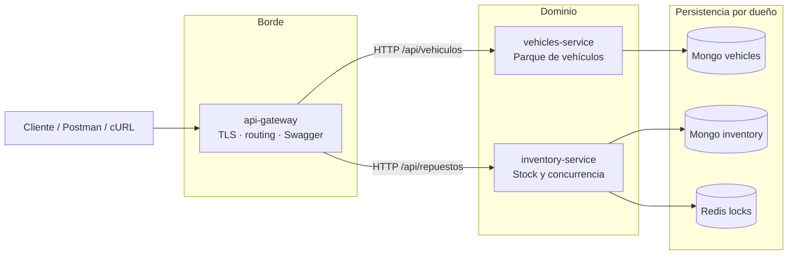
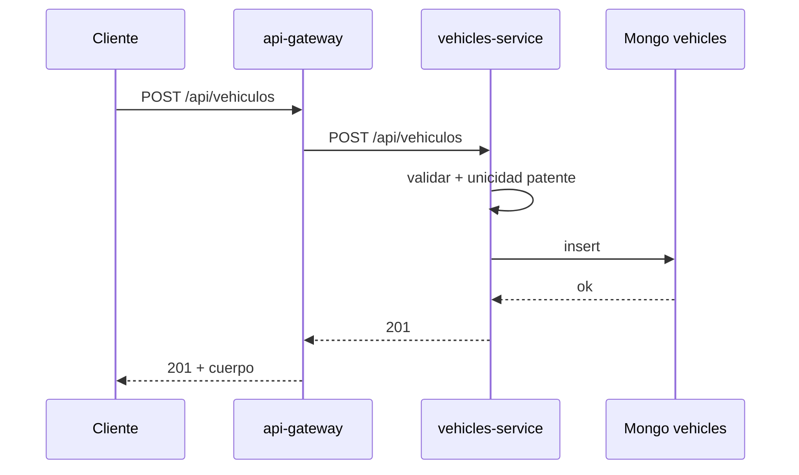
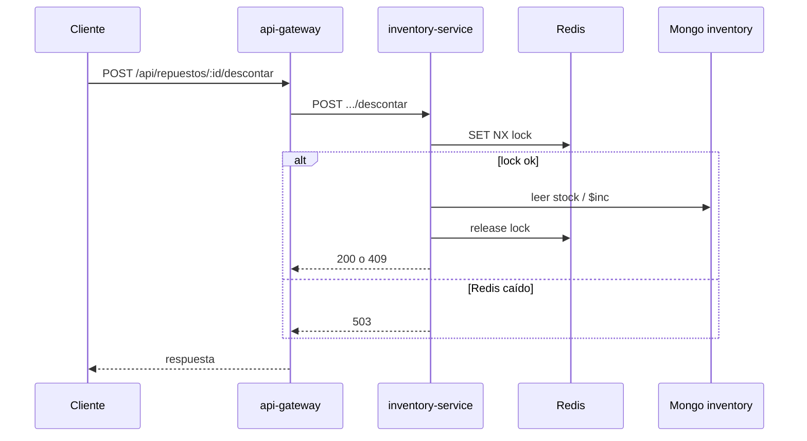

# Diagrama de arquitectura — torque (TP5)

Herramienta: Mermaid (renderiza en GitHub y en la mayoría de visores Markdown).

## Vista de servicios

## Casos de uso

### Alta de vehículo

### Descontar stock (camino seguro)

La justificación completa está en [arquitectura.md](./arquitectura.md).
