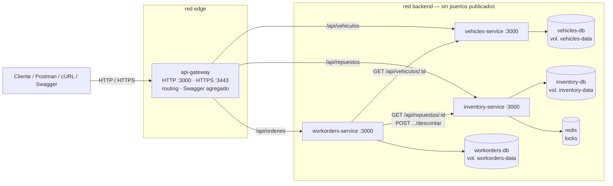

# TP6 · Hito 1 — Ratificación de la arquitectura

**Grupo torque** · Gregorio Luján · Manuel Moya · Jan Lahorca · Agustín Martínez

Punto de partida: arquitectura del TP5 (`docs/arquitectura.md`) y el monolito
del TP3 (`monolito/`). Este documento convierte esa propuesta en un plan de
implementación concreto **antes** de separar el código.

---

## 1. Matriz de implementación

| Microservicio | Responsabilidad | Endpoints a implementar | Datos propios | Dependencias |
|---|---|---|---|---|
| `vehicles-service` | Ciclo de vida del parque de vehículos | `GET/POST /api/vehiculos` · `GET/PUT/DELETE /api/vehiculos/:id` · `GET /health` | MongoDB `vehicles` → colección `vehiculos` (índice único `patente`) | Ninguna de negocio |
| `inventory-service` | Stock de repuestos y descuento sin corrupción concurrente | `GET /api/repuestos` · `GET /api/repuestos/:id` · `GET /api/repuestos/:id/lock` · `POST /api/repuestos/:id/descontar` · `POST /api/repuestos/:id/descontar-sin-lock` · `POST /api/repuestos/reiniciar` · `GET /health` | MongoDB `inventory` → colección `repuestos` · Redis `lock:repuesto:{id}` | Redis (infraestructura propia) |
| `workorders-service` **(nuevo)** | Órdenes de trabajo: registrar el trabajo sobre un vehículo y consumir repuestos | `GET/POST /api/ordenes` · `GET /api/ordenes/:id` · `GET /health` | MongoDB `workorders` → colección `ordenes` (guarda **ids** de vehículo y repuestos como referencias lógicas) | `vehicles-service` (HTTP) · `inventory-service` (HTTP) |
| `api-gateway` | Punto de entrada único: HTTPS, enrutamiento y Swagger agregado | `/api/vehiculos*` · `/api/repuestos*` · `/api/ordenes*` (proxy) · `/api-docs` · `GET /health` · `GET /health/servicios` | Ninguno de negocio (certificado montado, tabla de rutas) | Los tres servicios (HTTP) |

## 2. Propietario de cada endpoint del monolito

Cada endpoint del TP3 tiene **un único** servicio dueño. Ninguna regla de
negocio queda implementada en dos servicios a la vez.

| Endpoint del monolito (TP3) | Servicio dueño (TP6) | Regla de negocio que se lleva |
|---|---|---|
| `GET /api/vehiculos` | `vehicles-service` | — |
| `GET /api/vehiculos/:id` | `vehicles-service` | 400 id inválido / 404 |
| `POST /api/vehiculos` | `vehicles-service` | validación de campos · patente única (409) |
| `PUT /api/vehiculos/:id` | `vehicles-service` | ídem + reemplazo completo |
| `DELETE /api/vehiculos/:id` | `vehicles-service` | — |
| `GET /api/repuestos` | `inventory-service` | — |
| `GET /api/repuestos/:id` | `inventory-service` | 400 / 404 |
| `GET /api/repuestos/:id/lock` | `inventory-service` | diagnóstico del lock |
| `POST /api/repuestos/:id/descontar` | `inventory-service` | cantidad > 0 · stock insuficiente (409) · exclusión mutua Redis |
| `POST /api/repuestos/:id/descontar-sin-lock` | `inventory-service` | demo de carrera (TP2) |
| `POST /api/repuestos/reiniciar` | `inventory-service` | semilla de stock |
| `GET /api-docs` · `/api-docs.json` | cada servicio publica el suyo; `api-gateway` los agrega | — |
| HTTPS (TP2) | `api-gateway` | — |
| — (nuevo) `POST /api/ordenes` | `workorders-service` | vehículo debe existir · repuestos deben existir · el stock lo decide **inventory** |

## 3. Qué puede modificar cada servicio

| Servicio | Puede modificar | Puede consultar (solo vía HTTP) | No puede |
|---|---|---|---|
| `vehicles-service` | `vehiculos` | — | tocar stock ni órdenes |
| `inventory-service` | `repuestos`, locks en Redis | — | tocar vehículos ni órdenes |
| `workorders-service` | `ordenes` | vehículo (`GET /api/vehiculos/:id`), repuesto (`GET /api/repuestos/:id`); descuenta con `POST /api/repuestos/:id/descontar` | leer/escribir las bases `vehicles` o `inventory`; comparar stock por su cuenta |
| `api-gateway` | nada de negocio | todos (proxy) | reglas de patente, stock u órdenes |

## 4. Cambios respecto del TP5 (y por qué)

| Cambio | Justificación |
|---|---|
| **Se agrega `workorders-service`** | El TP5 dejaba previsto (checklist, §11) que si aparecía "usar un repuesto en un vehículo" se evaluaría un **cuarto bounded context de órdenes de trabajo** en lugar de fusionar vehicles e inventory. El TP6 pide comunicación real entre servicios y el análisis de un **fallo parcial** de una operación distribuida: con solo gateway → servicio no había ninguna operación con dos etapas que cambien estado. La orden de trabajo es esa operación (valida vehículo → descuenta stock → confirma orden) sin mezclar las responsabilidades de vehicles e inventory. |
| Una instancia de MongoDB **por servicio** (antes: "base o al menos DB name por servicio") | Se eligió la opción más estricta: cada servicio solo tiene la URI de su propia base y ninguna base publica puertos. Costo: 3 procesos `mongod` (se limita la caché de WiredTiger a 256 MB c/u). |
| HTTPS solo en el gateway; HTTP entre contenedores | Simplificación permitida por el TP6. El certificado autofirmado del TP2 se monta en el gateway (no va en la imagen). |
| Swagger: cada servicio publica su spec y el gateway los agrega en un selector | El TP5 decía "Swagger agregado en el gateway". Se implementó trayendo el `/api-docs.json` real de cada servicio, así la documentación coincide siempre con lo que corre. |
| Logs a stdout (sin archivos rotativos de Winston) | En contenedores los logs se consultan con `docker compose logs`. Los archivos dentro del contenedor son efímeros. |
| `monolito/` queda como referencia histórica | No forma parte del Compose. No se borró para conservar el historial del TP3/TP5. |

## 5. Plan de trabajo y reparto

| Integrante | Rama | Entrega |
|---|---|---|
| Gregorio Luján | `docs/tp6-plan` | Este plan (Hito 1) |
| Manuel Moya | `feature/vehicles-service` | `services/vehicles-service` (código, Dockerfile, README, Swagger) + `docs/tp6/casos-de-uso.md` + evidencia Docker propia |
| Jan Lahorca | `feature/inventory-service` | `services/inventory-service` (código, Dockerfile, README, Swagger, lock Redis) + `docs/tp6/semantica-errores.md` + evidencia Docker propia |
| Agustín Martínez | `feature/workorders-service` | `services/workorders-service` (código, clientes HTTP, Dockerfile, README, Swagger) + `docs/tp6/fallo-parcial.md` + evidencia Docker propia |
| Gregorio Luján | `feature/api-gateway` · `feature/compose-integration` | `services/api-gateway` · `docker-compose.yml` · scripts de prueba · README raíz · evidencias integradas |

Orden de merge: plan → los tres servicios de dominio (en paralelo, carpetas
independientes) → gateway → integración Compose → tag `tp6-entrega`.

## 6. Diagrama

