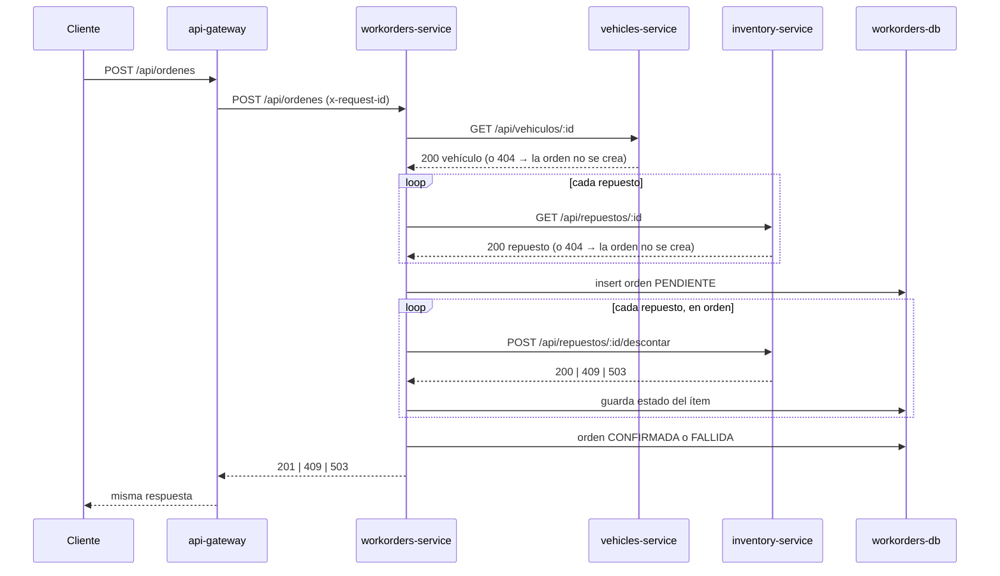

# TP6 · Recorrido de los casos de uso

Recorrido final de cada caso de uso principal después de la migración (TP6 §7).
Todas las entradas pasan por `api-gateway`, que solo enruta: no tiene reglas de
negocio.

## Resumen

| Caso de uso | Entrada | Servicio responsable | Servicios consultados | Resultado |
|---|---|---|---|---|
| CU1 · Alta de vehículo | `POST /api/vehiculos` `{marca, modelo, anio, patente, kilometraje}` | `vehicles-service` | — | `201` vehículo · `400` datos inválidos · `409` patente duplicada · `503` base caída |
| CU2 · Consultar / editar / borrar vehículo | `GET` · `PUT` · `DELETE /api/vehiculos/:id` | `vehicles-service` | — | `200` / `204` · `400` · `404` · `409` (PUT con patente ajena) |
| CU3 · Consultar stock | `GET /api/repuestos[/:id]` | `inventory-service` | — | `200` · `404` |
| CU4 · Descontar stock (camino seguro) | `POST /api/repuestos/:id/descontar` `{cantidad}` | `inventory-service` | Redis (infra propia) | `200` stock nuevo · `409` sin stock / recurso ocupado · `503` Redis caído |
| CU5 · Crear orden de trabajo | `POST /api/ordenes` `{vehiculoId, descripcion, repuestos[]}` | `workorders-service` | `vehicles-service`, `inventory-service` | `201` orden CONFIRMADA · `404` vehículo/repuesto inexistente · `409` orden FALLIDA por stock · `503` dependencia caída |
| CU6 · Consultar órdenes | `GET /api/ordenes[?estado=&vehiculoId=]` · `GET /api/ordenes/:id` | `workorders-service` | — (usa sus propios datos) | `200` · `404` |

## CU1 — Alta de vehículo

```
Cliente ──POST /api/vehiculos──▶ api-gateway ──POST /api/vehiculos──▶ vehicles-service
                                                                     │ valida campos
                                                                     │ insert en vehicles-db (índice único patente)
Cliente ◀──────── 201 / 400 / 409 ─────────────────────────────────────┘
```

La regla de patente única vive solo en `vehicles-service` (índice único en su
base). Si `vehicles-db` está caída responde `503` con
`"La base de datos de vehicles-service no está disponible."` y el proceso sigue
vivo.

## CU4 — Descontar stock (camino seguro)

```
Cliente ──POST /api/repuestos/:id/descontar──▶ api-gateway ──▶ inventory-service
                                                               │ SET lock:repuesto:{id} NX PX 8000   (redis)
                                                               │ leer stock → validar → $inc         (inventory-db)
                                                               │ liberar lock (Lua, solo si el token es propio)
Cliente ◀── 200 stock nuevo │ 409 "Stock insuficiente" │ 409 "Recurso ocupado" │ 503 Redis caído
```

Es el mismo mecanismo del TP2/TP3. En Docker el coordinador es el contenedor
`redis`; en Windows local puede ser Memurai: solo cambia `REDIS_URL`.

## CU5 — Crear orden de trabajo (caso distribuido)



- `workorders-service` **no** compara stock: eso es regla de `inventory-service`.
  Solo interpreta su respuesta (`200` descontado, `409` conflicto).
- Guarda `vehiculoId` y `repuestoId` como **referencias lógicas** y una copia de
  `patente` / `codigo` para mostrar la orden sin volver a consultar.
- El mismo `x-request-id` aparece en los logs de los cuatro servicios
  (evidencia: `docs/tp6/evidencias/05-comunicacion.txt`).
- Si una etapa posterior falla, la orden queda `FALLIDA` y puede haber stock ya
  descontado: ver [fallo-parcial.md](./fallo-parcial.md).

## Cómo repetirlos

```bash
bash scripts/pruebas-tp6.sh 04-crud          # CU1–CU4
bash scripts/pruebas-tp6.sh 05-comunicacion  # CU5–CU6
```

O desde Swagger: `http://localhost:3000/api-docs` → selector arriba a la derecha.
