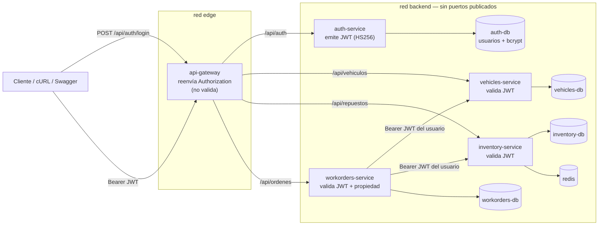

# TP7 · Hito 1 — Modelo de seguridad y clasificación de endpoints

**Grupo torque** · Gregorio Luján · Manuel Moya · Jan Lahorca · Agustín Martínez

Punto de partida: la solución del TP6 (`tp6-entrega`). Hasta ahí cualquier
cliente podía ejecutar cualquier operación. Este documento define, **antes**
de escribir código, qué identidad existe en el dominio, quién es responsable de
ella y qué puede hacer cada perfil.

---

## 1. Qué identidad existe en el dominio

torque es el sistema interno de un taller mecánico. Lo usan **personas del
taller**, no clientes finales:

| Perfil | Quién es | Qué hace en el sistema |
|---|---|---|
| `MECANICO` | empleado del taller | recibe vehículos, consulta el catálogo de repuestos, abre órdenes de trabajo y consume stock |
| `ADMIN` | jefe de taller | todo lo anterior + baja de vehículos, operaciones de laboratorio sobre el stock, ver las órdenes de todos y administrar usuarios |

Los endpoints que **necesitan conocer la identidad** son los que modifican
datos del taller (vehículos, stock, órdenes) y los que exponen datos que no
son públicos (patentes, órdenes). Las operaciones que **requieren autorización
adicional** son las bajas, las operaciones de diagnóstico/laboratorio y la
consulta de órdenes ajenas.

## 2. Componente responsable de identidad

**Se crea `auth-service`.** El TP6 no tiene ningún servicio con propiedad sobre
usuarios (vehicles, inventory y workorders son del negocio del taller), así que
no existe un "users-service" donde integrar la autenticación.

| Decisión | Justificación |
|---|---|
| `auth-service` nuevo, con base propia `auth-db` → colección `usuarios` | Única autoridad sobre credenciales. Nadie más guarda usuarios ni compara contraseñas. |
| Responsabilidad acotada: registro, login, emisión de JWT, administración de usuarios | No se le agregan reglas del taller (stock, órdenes, patentes): esas siguen en su servicio dueño. |
| Los demás servicios **no** consultan `auth-db` ni llaman a auth-service por request | Validan el JWT localmente (firma + vencimiento). Ver §6. |

## 3. Modelo de usuario

| Campo | Ejemplo | Observación |
|---|---|---|
| `_id` → `sub` | ObjectId | identificador estable que viaja en el token |
| `email` | `mecanico1@torque.local` | dato de login, único (índice único, en minúsculas) |
| `nombre` | `Juan Pérez` | solo para mostrar; **no** va en el token |
| `passwordHash` | `$2b$12$…` | **bcrypt** costo 12 (`bcryptjs`), salt incluido. `select: false` |
| `rol` | `MECANICO` \| `ADMIN` | un rol por usuario |
| `activo` | `true` | permite deshabilitar sin borrar el historial |

- **Registro público** (`POST /api/auth/register`): siempre crea `MECANICO`. Si el body trae `rol`, responde 400: nadie puede auto-asignarse ADMIN.
- **Primer ADMIN**: lo crea auth-service al arrancar con `ADMIN_EMAIL` / `ADMIN_PASSWORD` del `.env` (no versionado).
- **Promover / deshabilitar**: `PATCH /api/auth/usuarios/:id` (solo ADMIN).
- **Cuenta deshabilitada**: el login responde **403** solo si la contraseña es correcta. Con contraseña incorrecta, el mismo 401 genérico que cualquier otro caso.

## 4. Matriz de clasificación de endpoints (Hito 1)

| Servicio | Endpoint | Acceso | Rol / permiso | Justificación |
|---|---|---|---|---|
| auth-service | `POST /api/auth/register` | Público | — | Alta de mecánicos; el rol no lo elige el cliente. |
| auth-service | `POST /api/auth/login` | Público | — | Es la forma de obtener un token. |
| auth-service | `GET /api/auth/me` | Autenticado | MECANICO, ADMIN | Perfil del dueño del token. |
| auth-service | `GET /api/auth/usuarios` | Restringido | ADMIN | Administración de cuentas. |
| auth-service | `PATCH /api/auth/usuarios/:id` | Restringido | ADMIN | Cambiar rol o deshabilitar. |
| vehicles-service | `GET /api/vehiculos` · `GET /:id` | Autenticado | MECANICO, ADMIN | Patentes y datos del parque: no son públicos. |
| vehicles-service | `POST /api/vehiculos` · `PUT /:id` | Autenticado | MECANICO, ADMIN | Recibir y actualizar vehículos es tarea diaria del mecánico. |
| vehicles-service | `DELETE /api/vehiculos/:id` | Restringido | ADMIN | Borra datos y deja órdenes con referencia huérfana. |
| inventory-service | `GET /api/repuestos` · `GET /:id` | **Público** | — | Catálogo de repuestos con stock: consulta sin efectos. |
| inventory-service | `POST /api/repuestos/:id/descontar` | Autenticado | MECANICO, ADMIN | Consumir stock queda asociado a una persona (lo invoca workorders con el token del usuario). |
| inventory-service | `POST /api/repuestos/reiniciar` | Restringido | ADMIN | Pisa el stock con la semilla (laboratorio). |
| inventory-service | `GET /api/repuestos/:id/lock` | Restringido | ADMIN | Diagnóstico del lock Redis (estado interno). |
| inventory-service | `POST /api/repuestos/:id/descontar-sin-lock` | Restringido | ADMIN | Demo de carrera: puede dejar stock negativo. |
| workorders-service | `POST /api/ordenes` | Autenticado | MECANICO, ADMIN | La orden queda a nombre del usuario (`creadaPor`). |
| workorders-service | `GET /api/ordenes` | Autenticado + propiedad | MECANICO: solo las suyas · ADMIN: todas | §5. |
| workorders-service | `GET /api/ordenes/:id` | Autenticado + propiedad | MECANICO: solo si la creó · ADMIN: todas | §5. Ajena → 403. |
| todos | `GET /health` · `GET /api-docs` | Público | — | Healthcheck de Compose y documentación. |

### Matriz de autorización (formato §11)

| Servicio | Endpoint | Público | MECANICO | ADMIN |
|---|---|---|---|---|
| auth | `POST /api/auth/register` · `POST /api/auth/login` | Sí | Sí | Sí |
| auth | `GET /api/auth/me` | No | Sí | Sí |
| auth | `GET/PATCH /api/auth/usuarios…` | No | No | Sí |
| vehicles | `GET/POST/PUT /api/vehiculos…` | No | Sí | Sí |
| vehicles | `DELETE /api/vehiculos/:id` | No | No | Sí |
| inventory | `GET /api/repuestos…` | Sí | Sí | Sí |
| inventory | `POST /api/repuestos/:id/descontar` | No | Sí | Sí |
| inventory | `reiniciar` · `lock` · `descontar-sin-lock` | No | No | Sí |
| workorders | `POST /api/ordenes` | No | Sí | Sí |
| workorders | `GET /api/ordenes…` | No | Solo las propias | Todas |

## 5. Propiedad del recurso (§11.2)

El rol **no alcanza** para las órdenes de trabajo: dos mecánicos tienen el
mismo rol, pero uno no debería ver las órdenes del otro.

- Al crear la orden, workorders guarda `creadaPor = sub` del token.
- `GET /api/ordenes` filtra por `creadaPor` si el rol es MECANICO.
- `GET /api/ordenes/:id` de otro usuario → **403** `"La orden pertenece a otro usuario."`.
- La regla vive en workorders-service, que es el dueño de las órdenes. No consulta a auth-service: alcanza con el `sub` del token.

En vehículos y repuestos no hay propiedad por usuario (son del taller), así
que ahí alcanza con el rol.

## 6. JWT y validación entre servicios

| Tema | Decisión |
|---|---|
| Emisor | auth-service (`iss = torque-auth`, `aud = torque`) |
| Algoritmo | **HS256** con `JWT_SECRET` (≥ 32 caracteres, aleatorio) por variable de entorno |
| Claims | `sub`, `rol`, `iat`, `exp`, `iss`, `aud`. **Sin** email, nombre, contraseña ni hash |
| Vencimiento | `JWT_EXPIRES_IN` (por defecto `15m`) |
| Quién valida | vehicles, inventory, workorders y auth (`/me`, `/usuarios`), cada uno con el mismo middleware `src/middleware/auth.js` |
| Qué se rechaza | sin token, mal formado, firma inválida, otro algoritmo (incluido `none`), otro emisor/audiencia, vencido → **401** |
| Gateway | **no** valida: reenvía `Authorization` sin tocarlo. Cada servicio valida por su cuenta (nadie confía en "ya lo revisó otro") |
| Secreto compartido | por variable de entorno desde `.env` (Compose usa un ancla `x-jwt-env`). Nunca en el código ni en la imagen |
| Propagación | workorders reenvía el **mismo** token del usuario a vehicles e inventory |
| auth-service caído | los tokens ya emitidos siguen valiendo hasta su `exp` (validación local). Solo falla el login (503 del gateway) |

## 7. Plan de trabajo y reparto

| Integrante | Rama | Entrega |
|---|---|---|
| Gregorio Luján | `docs/tp7-plan` | Este plan (Hito 1) |
| Gregorio Luján | `feature/auth-service` | `services/auth-service` (registro, login, bcrypt, emisión JWT, admin inicial, Swagger, Dockerfile, README) |
| Manuel Moya | `feature/vehicles-auth` | middleware JWT + RBAC en `vehicles-service` (DELETE solo ADMIN), Swagger con Bearer/401/403, README + `docs/tp7/errores-401-403.md` |
| Jan Lahorca | `feature/inventory-auth` | middleware JWT + RBAC en `inventory-service` (catálogo público, descontar autenticado, laboratorio ADMIN), Swagger, README + `docs/tp7/secretos-y-configuracion.md` |
| Agustín Martínez | `feature/workorders-auth` | middleware JWT en `workorders-service`, **propagación del token** a vehicles/inventory, **regla de propiedad** (`creadaPor`), Swagger, README + `docs/tp7/propagacion-y-propiedad.md` |
| Gregorio Luján | `feature/tp7-integration` | gateway (`/api/auth`, reenvío de `Authorization`, Swagger con login), Compose (`auth-service`, `auth-db`, `JWT_SECRET`), `scripts/generar-env.sh`, `scripts/pruebas-tp7.sh`, README raíz, evidencias integradas |

Orden de merge: plan → auth-service → los tres servicios de dominio (en
paralelo, carpetas independientes) → integración → tag `tp7-entrega`.

## 8. Diagrama

`JWT_SECRET` llega por entorno a auth-service (firma) y a vehicles,
inventory y workorders (verificación). Ningún servicio fuera de auth-service
tiene la URI de `auth-db`.
